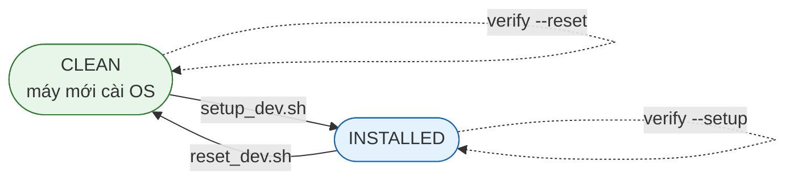

<div align="center">

# tuanlee-ubuntu-workstation

**Bộ script bash tiếng Việt chuẩn hóa máy Ubuntu Desktop cho đội lập trình web/app**

Cài môi trường · Gỡ sạch có kiểm soát · Chẩn đoán hiệu năng · Xác thực trạng thái · Quản lý nginx & project local


</div>

---

## Mục lục

- [Tổng quan](#tổng-quan)
- [Yêu cầu hệ thống](#yêu-cầu-hệ-thống)
- [Bắt đầu nhanh](#bắt-đầu-nhanh)
- [Script `setup_dev.sh`](#script-setup_devsh)
- [Script `reset_dev.sh`](#script-reset_devsh)
- [Script `optimize_dev.sh`](#script-optimize_devsh)
- [Script `verify_dev.sh`](#script-verify_devsh)
- [Script `nginx_dev.sh`](#script-nginx_devsh)
- [Quy trình làm việc chuẩn](#quy-trình-làm-việc-chuẩn)
- [Kiến trúc trạng thái](#kiến-trúc-trạng-thái)
- [Nhật ký thay đổi](#nhật-ký-thay-đổi)
- [Xử lý sự cố nhanh](#xử-lý-sự-cố-nhanh)
- [Cấu trúc thư mục](#cấu-trúc-thư-mục)

---

## Tổng quan

| Script | Vai trò | Khi nào dùng |
|---|---|---|
| **`setup_dev.sh`** | Cài toàn bộ môi trường lập trình sau khi cài OS (menu, từng mục độc lập) | Máy mới cài OS, onboarding thành viên mới |
| **`reset_dev.sh`** | Gỡ sạch môi trường đã cài về đúng trạng thái mới cài OS — **không đụng data** | Test lại vòng cài đặt, debug script setup |
| **`optimize_dev.sh`** | Chẩn đoán và tối ưu an toàn khi máy chậm / giật lag / treo thoáng qua | Máy phản ánh chậm, build ì, Chrome treo |
| **`verify_dev.sh`** | State validator **read-only**: xác nhận state `INSTALLED` / `CLEAN` đúng thiết kế | Sau setup/reset, trước khi bàn giao máy |
| **`nginx_dev.sh`** | Cài / gỡ nginx + quản lý project local (thêm · sửa · bật/tắt · xóa site) | Muốn serve project bằng nginx thay Apache, hoặc cần bộ site `*.test` độc lập |

### Đặc tính chung của cả 5 script

| Đặc tính | Ý nghĩa |
|---|---|
| Menu tiếng Việt | Chạy tương tác, chọn số |
| Cô lập lỗi | Mục nào lỗi chỉ được ghi nhận rồi bỏ qua — **không làm dừng các mục khác** |
| Idempotent | Chạy lại nhiều lần an toàn — đã cài / đã sạch thì tự bỏ qua |
| Log mỗi phiên | `logs/setup_*.log` · `logs/reset_*.log` · `logs/optimize_*.log` · `logs/verify_*.log` · `logs/nginx_*.log` |
| Tổng kết cuối phiên | Liệt kê đúng những mục FAIL kèm đường dẫn log |
| Nhận diện user thật | Cài vào home của user đang đăng nhập (qua `SUDO_USER`) — không rơi vào `/root` |

---

## Yêu cầu hệ thống

| Thành phần | Yêu cầu |
|---|---|
| Hệ điều hành | Ubuntu Desktop 22.04 / 24.04 *(đã kiểm tra trên 24.04 LTS)* |
| Tài khoản | User thường + quyền `sudo` — **không** đăng nhập root trực tiếp |
| Mạng | Có kết nối Internet |
| Trình duyệt để đọc doc | GitHub/GitLab render đầy đủ badge, bảng và sơ đồ |

```bash
git clone <repo-url> tuanlee-ubuntu-workstation
cd tuanlee-ubuntu-workstation
```

> Tất cả script đều chạy theo cùng một mẫu: `sudo bash <script>.sh`

---

## Bắt đầu nhanh

```bash
sudo bash setup_dev.sh              # 1. cài môi trường (hoặc chọn mục [17] cài tất cả)
sudo bash verify_dev.sh --setup     # 2. xác nhận state INSTALLED — kỳ vọng 0 FAIL
sudo bash reset_dev.sh              # 3. (tuỳ chọn) gỡ sạch để test lại vòng cài
sudo bash verify_dev.sh --reset     # 4. xác nhận state CLEAN + data được bảo vệ
sudo bash nginx_dev.sh              # 5. (tuỳ chọn) cài nginx + quản lý project local
```

---

## Script `setup_dev.sh`

```bash
sudo bash setup_dev.sh
```

<details>
<summary><b>Xem menu đầy đủ</b></summary>

```text
--- WEB BACKEND ---
[1]  Cập nhật hệ thống (apt update/upgrade)
[2]  Cài Git
[3]  Cài Apache2 (+ mod_rewrite)
[4]  Cấu hình Apache nhiều project (localhost/tenproject)
[5]  Cài PHP 8.3 + extensions
[6]  Cài NVM
[7]  Cài Node.js LTS (qua NVM — cần mục 6)

--- DESKTOP TOOLS ---
[8]  Cài Visual Studio Code
[9]  Cài Google Chrome
[10] Cài Vim
[11] Cài Meld
[12] Cài IBus Bamboo (gõ tiếng Việt)

--- FLUTTER / ANDROID ---
[13] Cài Flutter SDK (~/development/flutter)
[14] Cài Android Studio (tuỳ chọn, dung lượng lớn)

--- VIRTUAL HOST ---
[15] Tạo Virtual Host cho project (http://<tên>.test)
[16] Xóa Virtual Host

--- KHÁC ---
[17] Cài TẤT CẢ mục [1]→[14] (bỏ qua lỗi, tổng kết cuối)
[0]  Thoát
```

</details>

### Hai cách truy cập project web

| Cách | URL | Cấu hình |
|---|---|---|
| Theo folder | `http://localhost/ten_project` | Mục **[4]** ghi `DocumentRoot /var/www/html` + khối `<Directory>` với `AllowOverride All` — tự backup file gốc (.setup-bak-*) trước khi sửa |
| Virtual Host riêng | `http://ten_project.test` | Mục **[15]** sinh conf + thêm `/etc/hosts` + chạy `configtest` trước khi reload — **fail sẽ tự rollback** |

> `.test` là TLD do IANA dành riêng cho mục đích test: không trùng site thật, HTTP chạy ngay không cần chứng chỉ.

### Ghi chú sau khi cài

| Component | Việc cần làm tay |
|---|---|
| IBus Bamboo | *Settings → Keyboard → Input Sources* → `+` → thêm *Vietnamese (Bamboo)*; đổi bàn phím bằng `Super+Space`. Chưa thấy Bamboo thì đăng xuất/đăng nhập lại |
| Flutter | Mở terminal mới rồi chạy `flutter doctor` |
| Android Studio | Mở Studio cài Android SDK, sau đó chạy `flutter doctor --android-licenses` |

---

## Script `reset_dev.sh`

Dùng để test lại vòng cài đặt mà **không cần cài lại OS / không mất data**.

```bash
sudo bash reset_dev.sh
```

Menu đối chiếu 1-1 với setup: mỗi mục gỡ đúng thứ setup đó đã cài. Mỗi mục **in rõ danh sách sắp gỡ/xóa** rồi hỏi `(y/N)` một lần duy nhất.

### Nguyên lý

- Gói apt dùng `apt-get purge` → xóa cả binary lẫn cấu hình trong `/etc` → cài lại ra đúng cấu hình mặc định nguyên bản
- NVM / Flutter cài thủ công → xóa thư mục + **lọc đúng từng dòng** đã chèn vào `.bashrc`/`.profile` (dòng khác giữ nguyên từng byte)
- PPA Bamboo được gỡ khỏi `sources.list.d` / `trusted.gpg.d`
- Dòng `127.0.0.1 <tên>.test` được gỡ khỏi `/etc/hosts`

### Ranh giới dữ liệu

| Được bảo vệ tuyệt đối | Sẽ bị xóa (theo thiết kế) |
|---|---|
| Toàn bộ project trong `/var/www/html` | Settings/extensions VS Code (`~/.vscode`, `~/.config/Code`) |
| Documents, code, dotfile cá nhân | Profile Chrome (bookmarks, extensions…) |
| Bộ gõ `ibus` gốc của hệ thống (chỉ gỡ `ibus-bamboo`)<br>`vim-tiny`, `vim-common` mặc định của Ubuntu Desktop | Cache nặng Flutter/Android (`~/.pub-cache`, `~/Android/Sdk`, `~/.gradle`, AVD) |

---

## Script `optimize_dev.sh`

Dành cho máy báo chậm, giật lag, treo màn hình thoáng qua, Chrome treo, build Flutter ì ạch — dù cùng cấu hình.

```bash
sudo bash optimize_dev.sh
```

<details>
<summary><b>Xem menu đầy đủ</b></summary>

```text
[1] CHẨN ĐOÁN toàn diện (read-only — hãy chạy mục này trước!)
[2] Giảm áp lực RAM/Swap (swappiness=10, vfs_cache_pressure=50)
[3] Bật ZRAM (nén RAM — chữa treo do hết RAM)
[4] Tắt Tracker indexer (quét file ngầm)
[5] Tắt animation GNOME
[6] Dọn dung lượng (journal 200MB, apt, thumbnail, snap cũ)
[7] Gỡ kernel cũ (giữ bản đang chạy + mới nhất)
[8] Bật fstrim.timer (SSD)
[H] HOÀN TÁC các tinh chỉnh đã áp dụng
[0] Thoát
```

</details>

### Quy trình khuyến nghị

1. Chạy **[1] Chẩn đoán** — báo cáo dạng `[TỐT]` / `[CẢNH BÁO]` / `[NGUYÊN NHÂN?]`, mỗi phát hiện kèm "→ chạy mục [x]"
2. Áp dụng các mục được chỉ ra
3. Chạy lại **[1]** để xác nhận hết cảnh báo
4. Thấy phiền toái? **[H]** hoàn tác từng thay đổi qua manifest

### Những gì chẩn đoán tìm được

Lịch sử OOM killer (bằng chứng hết RAM gây treo) · render phần mềm `llvmpipe` (thiếu driver GPU) · áp lực swap · Tracker indexer · disk đầy · HDD vs SSD · kernel cũ · snap revision thừa · journal nặng · boot chậm ở service nào · unit failed · top process CPU/RAM

### Cam kết an toàn

- **Không sửa bất kỳ file cấu hình gốc nào của hệ thống** — mọi thay đổi là drop-in file riêng (`/etc/sysctl.d/99-dev-tuning.conf`, `/etc/systemd/journald.conf.d/…`) → xóa file = về mặc định
- Mọi thay đổi ghi vào manifest `backups/optimize_manifest.txt` (kèm giá trị cũ từng máy) → **[H] hoàn tác chính xác**
- Kernel: chỉ gỡ bản versioned, luôn giữ bản đang chạy + mới nhất; dừng nếu `dpkg` chưa hoàn tất trạng thái
- fstrim chỉ bật trên SSD; zram khuyến nghị theo dung lượng RAM thực tế

---

## Script `verify_dev.sh`

State validator **read-only tuyệt đối** — trả lời chính xác 5 câu hỏi:

1. Setup đã cài đủ chưa?
2. Version / config đúng như thiết kế chưa?
3. Reset đã gỡ đúng những gì setup quản lý chưa?
4. Reset có vô tình xóa data được bảo vệ không?
5. Chạy lặp có tạo duplicate / trạng thái bất thường không?

### Cú pháp

```bash
sudo bash verify_dev.sh --setup  [--skip component,component]
sudo bash verify_dev.sh --reset  [--skip component,component]
sudo bash verify_dev.sh --all    # chạy cả 2 suite, kết quả đọc theo từng suite
```

| Mode | Xác minh state | Suite kiểm tra |
|---|---|---|
| `--setup` | `INSTALLED` (sau `setup_dev.sh`) | 20 hạng mục |
| `--reset` | `CLEAN` (sau `reset_dev.sh`) | Gỡ sạch + data được bảo vệ |
| `--all` | Cả hai liên tiếp | Hai tổng kết riêng biệt |

**Exit code:** `0` = không có FAIL · `1` = có ít nhất một FAIL · `2` = sai tham số/thiếu quyền — tiện tích hợp CI/cron.

### Bốn mức verdict

| Verdict | Ý nghĩa |
|---|---|
| `[PASS]` | Đúng expected state |
| `[FAIL]` | Chắc chắn sai — in `Expected:` / `Found:` / `→ gợi ý xử lý thủ công` |
| `[WARN]` | Khác biệt đáng chú ý nhưng chưa đủ coi là thất bại (VD: binary còn nhưng package đã gỡ = nguồn cài ngoài apt) |
| `[SKIP]` | Không áp dụng (component bị `--skip`, hoặc vhost chưa từng tạo) |

### Output mẫu

```text
$ sudo bash verify_dev.sh --setup

===============================================================
  VERIFY SUITE: SETUP — trạng thái mong đợi là INSTALLED
===============================================================
  [PASS] Git (git version 2.43.0)
  [PASS] Apache2 (active + enabled)
  [PASS] mod_rewrite
  [PASS] Apache configtest (Syntax OK)
  [PASS] PHP 8.3 (8.3.6)
  [PASS] Flutter (3.47.1, owner=vcc, PATH đúng 1 lần)
  ...
  [SKIP] Virtual Host

================ TỔNG KẾT VERIFY (STATE: INSTALLED) ================
  PASS: 19   FAIL: 0   WARN: 0   SKIP: 1
Log: /home/vcc/tuanlee/script/logs/verify_20260826_141910.log
```

### Kiểm tra THEO EXPECTED STATE, không phải "lệnh có tồn tại"

Verify so khớp **trạng thái thiết kế**, ví dụ:

- **Node.js**: phải resolve qua đúng đường dẫn `~/.nvm/versions/node/*/bin` (chứng minh đúng install method), version dạng semver, alias `default` tham chiếu `lts/*`
- **NVM**: owner của `~/.nvm` phải là user thật (không phải root), khối config trong `.bashrc` xuất hiện **đúng 1 lần** (>1 = FAIL duplicate)
- **mod_rewrite**: symlink `mods-enabled/rewrite.load` **và** module xuất hiện trong `apache2ctl -M`
- **Apache configtest**: tin vào **exit code** của `apache2ctl configtest` thay vì parse text (chữ `Syntax OK` nằm ở stderr)
- **Flutter**: owner SDK phải là user thật, version đọc từ `bin/cache/flutter.version.json` (chuẩn SDK mới), PATH trong rc-files đúng 1 lần

### Duplicate detectors

Khối NVM ×N trong rc-files · dòng PATH Flutter ×N · hosts entry trùng domain · `ServerName *.test` trùng giữa 2 conf · PPA bamboo ×N entry.

### Protected data (verify cả 2 mode)

`/var/www/html` · `$HOME/Documents` · `vim-tiny`/`vim-common` (tồn tại **không** tính lỗi) · `ibus` hệ thống. Reset mà mất các mục này → FAIL kèm nhãn **CRITICAL**.

### Read-only tuyệt đối

Không apt / snap / sửa config / restart service / tự fix. Chỉ đọc, phân tích, báo cáo + gợi ý lệnh xử lý thủ công. Flutter version được đọc từ file SDK thay vì execute để tránh ghi cache.

### Tokens hợp lệ cho `--skip`

```text
git  apache  rewrite  configtest  conf  php  nvm  node  vscode
chrome  vim  meld  bamboo  flutter  android  vhost  hosts  rootuser  www  documents
```

### Giới hạn đã biết (thiết kế trung thực)

- Không chứng minh được các dòng KHÁC trong `.bashrc` nguyên vẹn byte sau reset nếu thiếu snapshot trước đó — verify xác minh được: dòng NVM/Flutter = 0 và file vẫn tồn tại
- Trên máy chủ thể có sẵn git/php/vim… cài ngoài repo, suite `--reset` có thể WARN "binary còn" — đây đúng semantics: binary thuộc nguồn cài lạ, không phải do setup quản lý

---

## Script `nginx_dev.sh`

Cài đặt / gỡ cài đặt nginx và quản lý project local — độc lập với 4 script kia, cùng pattern menu tiếng Việt.

```bash
sudo bash nginx_dev.sh
```

<details>
<summary><b>Xem menu đầy đủ</b></summary>

```text
--- NGINX ---
[1] Cài nginx (kiểm tra cổng 80 trước)
[2] Trạng thái (service · cổng · nginx -t · site)

--- QUẢN LÝ PROJECT ---
[3] Tạo project mới (folder + index + vhost)
[4] Thêm project có sẵn (folder → http://<tên>.test)
[5] Danh sách site + BẬT/TẮT
[6] Sửa cấu hình site (editor / domain / docroot)
[7] Xóa site (giữ nguyên file project)

--- NGHIỆP VỤ ---
[8] Gỡ hoàn toàn nginx
[9] Bật lại Apache cổng 80 · tạm tắt nginx
[0] Thoát
```

</details>

### Xung đột cổng 80 với Apache2

`setup_dev.sh` cài Apache2 và giữ cổng 80. Khi chạy mục **[1]**, script phát hiện cổng 80 đang bị chiếm và **hỏi người dùng** — không tự ý đụng service khác:

| Lựa chọn | Hệ quả | Cách hoàn tác |
|---|---|---|
| **[1] Đổi Apache sang `8080`** | Apache vẫn chạy ở `:8080`, nginx giữ `:80`. Tự backup file gốc (hậu tố `.nginxdev.bak`) | Gỡ nginx (mục **[8]**) tự đưa Apache về `:80` |
| **[2] Dừng + tắt Apache** | nginx giữ trọn `:80` | Gỡ nginx (mục **[8]**) tự `enable --now apache2` |
| **[3] Hủy** | Không cài gì | — |

Những gì script làm với Apache được ghi vào manifest `backups/nginx_state.txt` → gỡ nginx biết phải hoàn tác gì.

**Đảo chiều bằng mục [9]** — muốn quay lại Apache làm server chính mà chưa muốn gỡ nginx:

| Mục **[9]** làm | Ghi chú |
|---|---|
| `systemctl stop + disable nginx` | Tạm tắt — không tự bật lại khi boot; **mục [1] sẽ bật lại** nginx (kèm hỏi nhường cổng 80 lần nữa) |
| Đưa Apache về `:80` | Hoàn tác backup `.nginxdev.bak` nếu trước đó đã đổi sang `8080`, hoặc `enable --now apache2` nếu trước đó đã dừng |
| Xác minh | Hỏi `(y/N)` trước, rồi kiểm tra ai thực sự giữ cổng 80 |

> Trong lúc tạm tắt, site nginx (`http://<tên>.test`) không phản hồi; Apache vhost cũ (nếu có) hoạt động trở lại trên `:80`.

### PHP khi tạo site

| Tình huống | Khi tạo site |
|---|---|
| **Đã có socket `php-fpm`** | Dùng ngay → site chạy PHP |
| **Project có file PHP** mà máy chưa có `php-fpm` | **Hỏi trước**: `Cài PHP-FPM ngay? (Y/n, Enter = có)` → cài rồi sinh block `fastcgi_pass` |
| Project không có PHP, máy chưa từng cài PHP | Tự cài `php-fpm` + extensions |
| Project không có PHP, máy đã có PHP (module Apache) | Site chạy **static HTML** + in gợi ý `sudo apt install php-fpm` |

Conf chỉ gắn block `fastcgi_pass` khi socket `/run/php/php*-fpm.sock` tồn tại — tránh `nginx -t` fail vì thiếu module. Ở chế độ static, conf có sẵn `location ~ \.php$ { return 404; }` để nginx **không phát source `.php`** thay vì chạy nó.

> `.htaccess` **không có tác dụng với nginx** — mọi rewrite/redirect trong đó phải đưa thẳng vào `server`/`location` (dùng mục **[6]** mở conf để thêm).

### Cam kết an toàn từng mục

| Mục | Nguyên tắc |
|---|---|
| **[3]/[4]** | Tên folder → `slugify` thành domain gợi ý (Enter = dùng ngay, gõ khác = đổi) → sinh conf → thêm `/etc/hosts` → `nginx -t` → **fail thì rollback toàn bộ** (conf + symlink + dòng hosts) |
| **[5]** Bật/tắt | `nginx -t` fail → trả symlink về trạng thái trước, không để hệ thống treo |
| **[6]** Sửa | Backup trước khi sửa → `nginx -t` fail → khôi phục file cũ |
| **[7]** Xóa site | Chỉ xóa conf + symlink + dòng hosts + log của site — **không đụng folder project** |
| **[8]** Gỡ nginx | `apt-get purge 'nginx*'` (kể cả module phụ) + `autoremove` + dọn `/etc/nginx` + dọn hosts + hoàn tác Apache. **Không bao giờ** đụng `/var/www` |
| **[9]** Bật lại Apache | Dừng nginx **trước**, mới đưa Apache về `:80` (tránh 2 service giành cổng) — có hỏi `(y/N)` |

> **Tên folder không cần phải là domain hợp lệ.** Mục **[3]/[4]** tự `slugify`: ngắt ranh giới chữ hoa → bỏ ký tự lạ → viết thường → cắt 63 ký tự. Ví dụ `nail360UserLight` → `nail360-user-light` → `http://nail360-user-light.test`. Mục **[4]** luôn in ra `Folder · Site/conf · Domain` rồi hỏi `Enter` để nhận mặc định hoặc gõ domain khác — gõ thiếu hậu tố sẽ tự thêm (`nail360` → `nail360.test`), gõ sai thì **hỏi lại** chứ không thoát, nhấn `Enter` lần nữa là dùng domain mặc định.

### Trạng thái do `nginx_dev.sh` quản lý

```text
backups/nginx_state.txt     ← APACHE_MODE=port|stopped · NGINX_MODE=paused · DOMAIN đã tạo
/etc/nginx/sites-available/ ← conf site (sinh bởi script)
/etc/nginx/sites-enabled/   ← symlink bật/tắt
```

---

## Quy trình làm việc chuẩn

```bash
# ── Máy mới cài OS xong ──────────────────────────────
sudo bash setup_dev.sh              # cài lần lượt từng mục, hoặc [17] cài tất cả
sudo bash verify_dev.sh --setup     # xác nhận state INSTALLED đúng

# ── Test lại từ đầu (nâng cấp script, nghi ngờ cài sai bước) ──
sudo bash reset_dev.sh              # [13] RESET TẤT CẢ
sudo bash verify_dev.sh --reset     # xác nhận state CLEAN + data được bảo vệ
sudo bash setup_dev.sh              # cài lại, so sánh kết quả

# ── Thành viên phản ánh máy chậm / treo ──────────────
sudo bash optimize_dev.sh           # [1] chẩn đoán → xử lý theo gợi ý → [1] xác nhận lại

# ── Chuyển serving project sang nginx ────────────────
sudo bash nginx_dev.sh              # [1] cài, chọn [1] đổi Apache sang 8080
sudo bash nginx_dev.sh              # [4] thêm folder có sẵn → http://ten.test
sudo bash nginx_dev.sh              # [5] bật/tắt site · [6] sửa · [7] xóa site
sudo bash nginx_dev.sh              # [9] đảo chiều: Apache lại :80, nginx tạm tắt
sudo bash nginx_dev.sh              # [1] bật lại nginx · [8] gỡ sạch khi không dùng nữa
```

---

## Kiến trúc trạng thái



Đường nét đứt = verify chỉ **quan sát**, không bao giờ làm thay đổi state.

---

## Nhật ký thay đổi

| Ngày | Script | Thay đổi |
|---|---|---|
| 02/10/2026 | `nginx_dev.sh` | Thêm công cụ cài/gỡ nginx + quản lý project local: menu [1]→[9], nhường cổng 80 cho Apache theo lựa chọn người dùng, mục **[9]** đảo chiều về Apache (tạm tắt nginx), rollback khi `nginx -t` fail, purge `nginx*` khi gỡ |

---

## Xử lý sự cố nhanh

| Hiện tượng | Xử lý |
|---|---|
| Script báo "Script cần quyền root" | Chạy đúng `sudo bash <script>.sh` từ user thường, không chạy bằng tài khoản root |
| Verify FAIL dù chạy thủ công thấy ổn | Đọc dòng `Expected:` / `Found:` / `→ …` ngay dưới mục FAIL — script mô tả chính xác tiêu chí nó so khớp; đối chiếu rồi sửa tay theo gợi ý |
| Sau gỡ Bamboo, Settings còn tên "Vietnamese (Bamboo)" | Chọn nó và nhấn `-`; vô hại nếu để nguyên |
| ZRAM chưa thấy hoạt động sau mục [3] | Khởi động lại máy rồi kiểm tra `swapon --show` |
| Hoàn tác kernel báo thiếu mạng | Hoàn tác kernel cần Internet để `apt-get install` lại đúng version đã ghi |
| Một mục FAIL liên tục | Mở file log trong `logs/` tương ứng phiên chạy, tìm dòng `[LỖI]` gần nhất |
| Cài nginx xong, `curl localhost` không ra site | Chạy mục **[2]** của `nginx_dev.sh` — nếu `Cổng 80` báo bị `apache2` chiếm nghĩa là khi cài đã chọn mục [3] Hủy |
| Chạy `setup_dev.sh` [3] xong, nginx chết vì Apache giành lại `:80` | Chạy lại `nginx_dev.sh` **[1]** (đã cài thì chỉ start) hoặc `[2]` để xem ai đang giữ cổng 80 |
| Mở `http://<tên>.test` ra trang mặc định của nginx | Host header chưa khớp `server_name` — kiểm tra dòng `127.0.0.1 <tên>.test` trong `/etc/hosts` (mục **[2]** liệt kê site) |
| Site báo 502 khi truy cập `index.php` | php-fpm chưa chạy — `systemctl start php8.3-fpm`, hoặc site đang ở chế độ static (xem mục **[2]**) |
| Vào `http://<tên>.test/` bị **403 Forbidden** | nginx không tìm thấy index. Đọc `/var/log/nginx/<tên>-error.log`: (a) `directory index ... is forbidden` → folder thiếu `index.html` **hoặc** project là PHP nhưng chưa cài `php-fpm` → chạy lại mục **[4]**, trả lời `y` khi được hỏi cài PHP-FPM; (b) thiếu quyền đọc docroot → `chmod 755` các thư mục cha |
| Đã thấy `[OK] Đã thêm ... vào /etc/hosts` nhưng trình duyệt vẫn `DNS_PROBE_FINISHED_NXDOMAIN` | `/etc/hosts` thiếu newline ở cuối file → entry bị dính vào dòng comment thành `##...##127.0.0.1 x.test`. Chạy lại mục **[4]** (ghi đè = `y`), script tự tách dòng và xác minh lại; `getent hosts <tên>.test` phải ra `127.0.0.1` |

---

## Cấu trúc thư mục

```text
tuanlee-ubuntu-workstation/
├── README.md                  ← tài liệu bạn đang đọc
├── setup_dev.sh               # cài môi trường lập trình
├── reset_dev.sh               # gỡ sạch về mặc định OS
├── optimize_dev.sh            # chẩn đoán + tối ưu an toàn
├── verify_dev.sh              # state validator (read-only) cho setup/reset
├── nginx_dev.sh               # cài/gỡ nginx + quản lý project local
├── .gitignore                 # bỏ qua logs/ và backups/
├── logs/                      # log tự sinh mỗi phiên chạy (git-ignore)
│   ├── setup_YYYYMMDD_HHMMSS.log
│   ├── reset_YYYYMMDD_HHMMSS.log
│   ├── optimize_YYYYMMDD_HHMMSS.log
│   ├── verify_YYYYMMDD_HHMMSS.log
│   └── nginx_YYYYMMDD_HHMMSS.log
└── backups/
    ├── optimize_manifest.txt  # manifest hoàn tác của optimize_dev.sh
    └── nginx_state.txt        # state Apache/hosts do nginx_dev.sh tự sinh
```

---

<div align="center">

<sub>Duy trì bởi team tuanlee · Chạy tốt nhất trên Ubuntu Desktop 24.04 LTS</sub>

</div>
